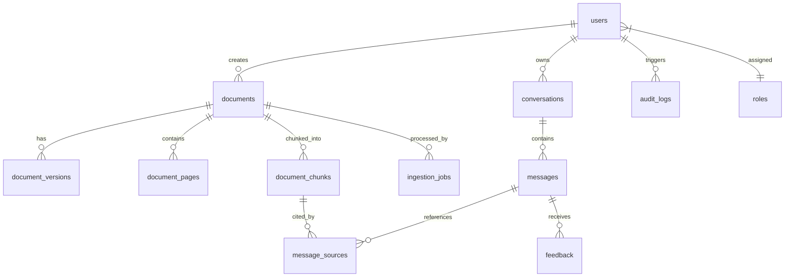

# BiztelAI Manufacturing SOP AI Copilot — Database & Indexing

The data persistence layer is engineered around **PostgreSQL 16** with the **pgvector** extension and **PostgreSQL Full-Text Search**, with a cross-dialect abstraction supporting SQLite for fast developer onboarding and unit testing.

---

## 1. Entity-Relationship Overview



---

## 2. Key Tables & Schemas

### `documents`
- `id`: UUID (Primary Key)
- `title`: String(255)
- `original_filename`: String(255)
- `stored_filename`: String(255)
- `sha256_hash`: String(64) — Unique constraint for file deduplication
- `status`: String(32) — Enum (`pending`, `processing`, `indexed`, `failed`)
- `category`: String(64) — Index for category-based filtering
- `department`: String(64) — Index for departmental access isolation
- `is_deleted`: Boolean — Soft-deletion flag

### `document_chunks`
- `id`: UUID (Primary Key)
- `document_id`: Foreign Key (`documents.id`, `ondelete="CASCADE"`)
- `page_id`: Foreign Key (`document_pages.id`)
- `chunk_index`: Integer
- `section_heading`: String(255)
- `subheading`: String(255)
- `content`: Text — Full chunk text
- `token_count`: Integer
- `embedding`: VectorType(384) — pgvector dense embedding column
- `embedding_model`: String(64) — Model identifier e.g. `all-MiniLM-L6-v2`
- `embedding_version`: Integer — Vector versioning flag

---

## 3. Vector & Full-Text Search Indexing

### pgvector Cosine Index
```sql
CREATE INDEX idx_document_chunks_embedding_cosine 
ON document_chunks 
USING ivfflat (embedding vector_cosine_ops) 
WITH (lists = 100);
```

### PostgreSQL Full-Text Search Index
```sql
CREATE INDEX idx_document_chunks_fts 
ON document_chunks 
USING gin (to_tsvector('english', content));
```

---

## 4. Model Versioning & Vector Isolation
To prevent mixing vectors from incompatible models:
1. Every vector stored in `document_chunks` records its generating `embedding_model` and `embedding_version`.
2. When the embedding model configuration changes (e.g. from `all-MiniLM-L6-v2` to a 768-dim model), existing vectors are never mixed. A migration or version bump is triggered, keeping search queries isolated to the active model version.

